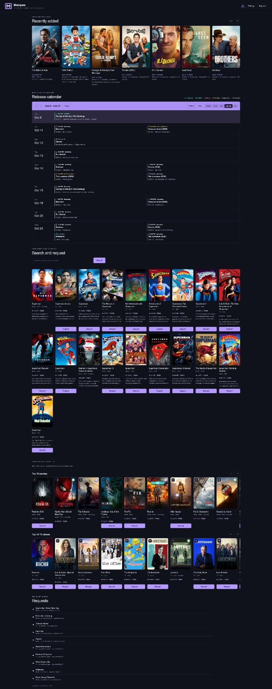
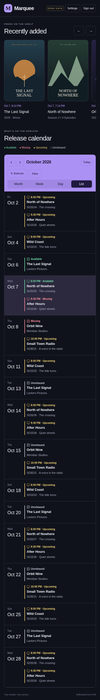

# Marquee

 

A self-hosted media dashboard with recent titles, a release calendar, personal Jellyfin shelves and Seerr discovery. Sign in with your Jellyfin account. Your recent titles follow your Jellyfin library permissions.



<details>
<summary>Mobile demo</summary>
<p align="center"></p>
</details>

### Network search and recent recommendations

Search keeps normal title results and offers matching TV networks as buttons. Pick a network to browse its newest series premieres, excluding future premieres, with page controls. This is network credit, not current streaming availability, and does not sort by the latest episode of an older show. Same-name networks show country or catalog ID so they are not silently merged.

The network directory is TMDB's full daily ID export, fetched on demand and persisted as `network-list.json` in the settings folder for 24 hours. A cached copy survives restarts and can be used during a temporary download outage. Displayed network identities use the existing TMDB key for country details and are cached for a day; without it, choices show their IDs. Directory failure never breaks title search. Each selected network page reads Seerr's TV discovery endpoint with the linked viewer's request state; normal watched/certification lookups still apply.

Recommendations stay based on the last five distinct watched movies/shows, but only picks released within a rolling five-year window are shown. Future or missing release dates are excluded. Available and partially available titles (including 4K-only copies) are excluded using existing Seerr metadata; existing Jellyfin provider-ID checks also remove library matches, even if unwatched. No extra availability calls are added. Seerr's recommendations endpoint has no release-date filter, so Marquee filters on the server before extra metadata work. A short recent pool stays short rather than filling with old titles.

## Beta

Marquee runs from source using the official Node image. There is no published Marquee image yet. The single-container stack below downloads the current beta when you restart or recreate it; a running app does not update itself.

## Contents

- [Features](#features)
- [Run with Docker Compose](#run-with-docker-compose)
- [Connection settings](#connection-settings)
- [Privacy and permissions](#privacy-and-permissions)

## Features

- Discover and On Jellyfin pages with hideable, collapsible shelves. Reorder shelves separately for each page in Settings.
- Recently added movies and TV seasons, with added dates, episode details and watched status from your Jellyfin account.
- Optional Continue watching, Next up and Watchlist shelves. Watchlist uses Jellyfin favorites; the filled heart removes a favorite. Episode favorites apply to the parent series.
- Optional Recommendations based on up to five latest distinct watched movies/shows, with related titles from Seerr/TMDB.
- Seerr search, popular movies/shows and requests, using your linked Seerr permissions and quotas. Requests can show Everyone or My requests when your Seerr permissions allow it.
- Shared Sonarr/Radarr release calendar with month, week, day, agenda and list views. Agenda is the default. Sunday-first layout, release filters, cinema/home releases and a status legend.
- Detail popouts with available cast, ratings, certifications, TV network and overview. Play/Resume opens Jellyfin; the YouTube button opens a trailer search. Missing metadata stays hidden.
- Small, Standard or Large posters on each device. Shelf arrows stay on desktop; phones and tablets swipe.
- Optional weather and five-day forecast, colorblind-friendly status colors, automatic shelf refresh and display-settings sync. Refresh checks run only in an open, visible browser tab, on the active page and for enabled sections: Recently added, Continue watching, Next up, Leaving soon, Requests and Calendar. They pause during interaction or an open dialog. Unchanged results leave cards in place; updated shelves reuse unchanged poster images. The interval is adjustable in General Settings (five minutes by default), including Off. Calendar and request checks use their existing upstream services; this does not add a background server polling job.
- Settings shows your Jellyfin server version and service connection tests. Jellyfin administrators can change the shared display name.
- Installable home-screen app (PWA). Demo mode uses fictional titles and needs no external credentials.

Personal shelves and weather start off. Enable them in Settings. Most display choices stay on the current device unless you enable sync; weather, colorblind mode and shelf order are saved per account. The watched badge is read-only and never changes viewing history.

## Run with Docker Compose

Use Docker Engine with the Compose plugin, or a stack manager such as CasaOS, Dockhand or Synology Container Manager. No image build is needed.

The recommended stack downloads the app for you. Use the [local-checkout option](#local-checkout-compose-requires-source-folder) only if you already keep the source folder on your server.

### Single-container stack (CasaOS, Dockhand, Synology or plain Docker)

This is the easiest option for a stack manager or plain Docker Compose. You do not need to download the source folder. Settings come from a `.env` file beside your compose file, or your stack manager's Environment settings.

1. Copy the complete example below into your stack editor, or save `compose.casaos.yaml` as your stack file.
2. Add the variables from the `.env` example below to a `.env` file beside your compose file, or to the stack's Environment settings. Fill in your own service URLs and API keys. Keep your keys private.
3. Set your timezone. Leave `DEMO_MODE` off for your real media.
4. Keep `COOKIE_SECURE` true for HTTPS. Use false only on a trusted plain-HTTP home network.
5. Set `MARQUEE_PORT` to your host port (usually `8739`). Keep `target: 8739` in the compose.
6. Start the stack. Open it through your HTTPS reverse proxy. Direct HTTP works only when `COOKIE_SECURE=false` on a trusted home network.

You only need to edit the settings above. The commented startup steps download Marquee, install its runtime packages, and start it automatically. Your server needs internet access to GitHub and npm during startup. If a download fails, startup stops rather than running an incomplete app.

**Updates:** restart or recreate the stack to download the latest beta. Compose changes require replacing the stack definition and recreating it; restarting alone does not apply a new compose. Keep your settings folder and environment values.

**Container name:** the container is named `marquee`. If you run a second Marquee instance on the same Docker host, give it a different `container_name`, host port and settings folder. The stack/project name is separate.

**Saved settings:** keep `/DATA/AppData/marquee/settings` when updating. It holds account settings, the display name and the generated session secret. Leaving `SESSION_SECRET` blank uses that saved secret; changing it signs everyone out. Sessions last 90 days from sign-in and can survive restarts when the folder and secret are unchanged. The container prepares folder ownership, then downloads and runs the app as the non-root `node` user.

**Platform notes:**

- CasaOS: use Custom Install and paste the full stack below. The default settings path fits CasaOS.
- Dockhand: create/edit the stack, paste the compose, and add its environment values.
- Synology Container Manager: use a Project and its compose editor. Change the settings source to your existing shared-folder path, for example `/volume1/docker/marquee/settings`.
- Plain Docker: save this as `compose.yaml` beside your `.env` and deploy with your Docker Compose interface. The source downloads automatically; no clone or permission commands are needed.

**Already using the two-container stack?** Keep your current settings source, environment values and port. Replace the compose with this complete example and recreate the stack. Remove the old stopped `marquee-init` container in your manager if it remains as an orphan; do not delete the settings folder. The app keeps its saved settings and session secret. If your NAS blocks ownership changes on that folder, startup will stop rather than silently losing saved settings.

```yaml
name: marquee
services:
  marquee:
    container_name: marquee
    image: node:22-alpine
    working_dir: /app
    # Root only prepares the settings folder; the app runs as node.
    user: "0:0"
    init: true
    # Downloads current main on restart; requires HTTPS access to GitHub and npm.
    command:
      - sh
      - -c
      - |
          set -eu

          # 1. Prepare saved settings, then switch to the non-root app user.
          chown -R 1000:1000 /home/node
          exec su node -s /bin/sh -c '
          set -eu

          # 2. Download Marquee from GitHub.
          wget -O /app/source.tar.gz \
            https://codeload.github.com/dhrandy/marquee/tar.gz/refs/heads/main

          # 3. Unpack the app and remove the download.
          tar -xzf /app/source.tar.gz -C /app --strip-components=1
          rm /app/source.tar.gz

          # 4. Leave tests and development files out of the running copy.
          rm -rf /app/tests /app/docs /app/.github \
            /app/playwright.config.js /app/README.md \
            /app/compose.yaml /app/compose.casaos.yaml \
            /app/.env.example /app/.gitignore

          # 5. Install only the packages the app needs to run.
          npm ci --omit=dev --ignore-scripts --no-audit --no-fund

          # 6. Start Marquee.
          exec node src/server.js
          '
    # Change published for your host port; keep target 8739.
    ports:
      - target: 8739
        published: "${MARQUEE_PORT}"
        protocol: tcp
    # Values come from your .env file or stack Environment settings.
    environment:
      TZ: ${TZ}
      DEMO_MODE: ${DEMO_MODE}
      # false only for a trusted plain-HTTP LAN; keep true behind HTTPS.
      COOKIE_SECURE: ${COOKIE_SECURE}
      SESSION_SECRET: ${SESSION_SECRET}
      TRUSTED_PROXIES: ${TRUSTED_PROXIES}
      TRUST_PROXY: ${TRUST_PROXY}
      JELLYFIN_URL: ${JELLYFIN_URL}
      SONARR_URL: ${SONARR_URL}
      SONARR_API_KEY: ${SONARR_API_KEY}
      RADARR_URL: ${RADARR_URL}
      RADARR_API_KEY: ${RADARR_API_KEY}
      SEERR_URL: ${SEERR_URL}
      SEERR_API_KEY: ${SEERR_API_KEY}
      TMDB_API_KEY: ${TMDB_API_KEY}
      MAINTAINERR_URL: ${MAINTAINERR_URL}
      MAINTAINERR_API_KEY: ${MAINTAINERR_API_KEY}
      # Browser-facing Jellyfin URL; blank falls back to JELLYFIN_URL.
      JELLYFIN_WEB_URL: ${JELLYFIN_WEB_URL}
    volumes:
      - type: bind
        # Persistent settings: keep this folder when updating.
        source: /DATA/AppData/marquee/settings
        target: /home/node
    tmpfs:
      - /app:uid=1000,gid=1000,mode=0700
      - /home/node/.npm:uid=1000,gid=1000,mode=0700
    read_only: true
    cap_drop:
      - ALL
    # Only needed for folder ownership and the startup user switch.
    cap_add:
      - CHOWN
      - DAC_OVERRIDE
      - SETUID
      - SETGID
    security_opt:
      - no-new-privileges:true
    restart: unless-stopped
    healthcheck:
      test:
        - CMD
        - su
        - node
        - -s
        - /bin/sh
        - -c
        - node -e "fetch('http://127.0.0.1:8739/api/config').then(r=>process.exit(r.ok?0:1)).catch(()=>process.exit(1))"
      interval: 30s
      timeout: 5s
      start_period: 60s
```

### Local-checkout compose (requires source folder)

1. Put your Marquee source folder on the server. Do not use an empty folder.
2. Save this compose beside the source and add the `.env` values below.
3. Start it through your stack manager. Updates use the source you have downloaded, not an automatic GitHub download.

This option mounts the source read-only and uses the `marquee-settings` named volume for saved settings and sign-ins. Keep that volume when updating. Startup needs access to npm.

```yaml
services:
  marquee:
    container_name: marquee
    image: node:22-alpine
    working_dir: /app
    user: node
    init: true
    command:
      - sh
      - -c
      - |
          set -e

          # Copy the app from your downloaded source folder.
          cp /source/package*.json /app/
          cp -R /source/src /source/public /app/

          # Install only the packages the app needs to run.
          npm ci --omit=dev --ignore-scripts --no-audit --no-fund

          # Start Marquee.
          exec node src/server.js
    ports:
      - "${MARQUEE_PORT}:8739"
    environment:
      TZ: ${TZ}
      DEMO_MODE: ${DEMO_MODE}
      COOKIE_SECURE: ${COOKIE_SECURE}
      SESSION_SECRET: ${SESSION_SECRET}
      TRUSTED_PROXIES: ${TRUSTED_PROXIES}
      TRUST_PROXY: ${TRUST_PROXY}
      JELLYFIN_URL: ${JELLYFIN_URL}
      SONARR_URL: ${SONARR_URL}
      SONARR_API_KEY: ${SONARR_API_KEY}
      RADARR_URL: ${RADARR_URL}
      RADARR_API_KEY: ${RADARR_API_KEY}
      SEERR_URL: ${SEERR_URL}
      SEERR_API_KEY: ${SEERR_API_KEY}
      TMDB_API_KEY: ${TMDB_API_KEY}
      MAINTAINERR_URL: ${MAINTAINERR_URL}
      MAINTAINERR_API_KEY: ${MAINTAINERR_API_KEY}
      JELLYFIN_WEB_URL: ${JELLYFIN_WEB_URL}
    volumes:
      - ./:/source:ro
      - marquee-settings:/home/node
    tmpfs:
      - /app:uid=1000,gid=1000,mode=0700
      - /home/node/.npm:uid=1000,gid=1000,mode=0700
    read_only: true
    cap_drop:
      - ALL
    security_opt:
      - no-new-privileges:true
    restart: unless-stopped
    healthcheck:
      test:
        [
          "CMD",
          "node",
          "-e",
          "fetch('http://127.0.0.1:8739/api/config').then(r=>process.exit(r.ok?0:1)).catch(()=>process.exit(1))",
        ]
      interval: 30s
      timeout: 5s
      start_period: 60s

volumes:
  marquee-settings:
```

### Environment values

Copy these into `.env` beside your compose, or into the stack manager's Environment settings. Replace service URLs and API keys with your own. Service names such as `jellyfin` work only on a shared Docker network; otherwise use a reachable LAN address. Leave optional Maintainerr values blank if unused. These are examples, not working credentials.

```dotenv
# Marquee settings. Copy to .env and fill in your own values. Keep .env private.

# Port on the host that Marquee listens on (container port stays 8739).
MARQUEE_PORT=8739
# Your timezone, for example America/New_York. List: en.wikipedia.org/wiki/List_of_tz_database_time_zones
TZ=Etc/UTC
# Demo mode shows fake titles with no login. For trying the app only - never for a real deployment.
DEMO_MODE=false
# true when Marquee sits behind an HTTPS reverse proxy (recommended). false only for a local HTTP demo.
COOKIE_SECURE=true
# Optional. Empty = generated once and kept in the data volume. Set 32+ random characters to pin it.
SESSION_SECRET=
# Comma-separated trusted reverse-proxy IPs/narrow CIDRs as seen by the container.
# Empty ignores X-Forwarded-For. Do not use a wildcard, true, or a hop count.
# Proxy must overwrite forwarded client headers; backend must not be publicly reachable.
TRUSTED_PROXIES=
# Simpler alternative: 1 trusts exactly one proxy hop (default off).
# ONLY if backend access is restricted to your proxy, including LAN/container callers.
# Current compose publishes on host interfaces; configure firewall/bind isolation yourself.
# Direct backend callers can spoof client IPs with this mode. Strict allowlist wins if set.
TRUST_PROXY=0

# Internal vs external URLs: the container talks to your services over your
# Docker/LAN network (internal). Deep links people tap on their phones use the
# public reverse-proxy address (external). Set both when they differ.

# Jellyfin internal URL: how this container reaches Jellyfin (Docker service name or LAN address).
JELLYFIN_URL=http://jellyfin:8096
# Jellyfin external URL: the address browsers open when you tap a poster. Falls back to JELLYFIN_URL.
JELLYFIN_WEB_URL=https://jellyfin.example.com

# Sonarr: base URL + API key (Settings > General in Sonarr).
SONARR_URL=http://sonarr:8989
SONARR_API_KEY=replace-with-your-sonarr-api-key
# Radarr: base URL + API key (Settings > General in Radarr).
RADARR_URL=http://radarr:7878
RADARR_API_KEY=replace-with-your-radarr-api-key

# Seerr (Jellyseerr or Overseerr): base URL + API key (Settings > General).
SEERR_URL=http://seerr:5055
SEERR_API_KEY=replace-with-your-seerr-api-key

# Optional In theaters shelf: your own TMDB API key (server-side only).
TMDB_API_KEY=

# Weather is set per viewer in Settings: city picker and F/C units.
# Open-Meteo weather and city search are free for non-commercial use. No API key or account needed.
# Dashboard display name is set by a Jellyfin administrator in Settings (default Marquee).

# Optional read-only Leaving soon shelf. Internal URL, including BASE_PATH if used.
# Maintainerr has no built-in API authentication; do not expose it publicly.
MAINTAINERR_URL=http://maintainerr:6246
# Optional compatibility header. Maintainerr does not validate this as protection.
MAINTAINERR_API_KEY=
```

Dockhand users can put these variables in the stack's Environment tab instead of a `.env` file. Only the local-checkout compose needs a source folder: change `./:/source:ro` to your checkout location if Dockhand's stack directory differs. The standalone stack downloads its own source. No particular host OS, NAS, or stack manager is required.

### Maintainerr Leaving soon (optional)

Set `MAINTAINERR_URL` to its internal container/LAN base URL (include its `BASE_PATH`, if set). `MAINTAINERR_API_KEY` is an optional `X-Api-Key` header, not authentication: Maintainerr does not validate inbound API keys. Do not publish Maintainerr's port publicly assuming a key protects it. Enable Leaving soon in Settings, where a connection test is also available.

The read-only shelf shows up to 24 accessible Jellyfin titles from active Maintainerr delete-file collections. Dates indicate eligibility, not guaranteed deletion: schedules, playback and later rule changes can delay it. Marquee checks exclusions and library access; it does not change Maintainerr settings, trigger actions or delete files. Old/Plex-only installs and versions without `/api/collections/overlay-data` are not supported.

### Reverse proxy

- Use HTTPS for Jellyfin sign-in. Forward to port 8739, preserve the original Host header, and do not cache `/api/` responses. Keep the HTTP backend off the public internet.
- Keep `COOKIE_SECURE=true` behind HTTPS. Set it false only for a trusted plain-HTTP home network.
- Leave proxy trust off unless you need forwarded client IPs. Prefer `TRUSTED_PROXIES` with the proxy's specific IPs or narrow CIDRs, as seen by the container. Never trust all addresses or a shared gateway reachable by untrusted clients.
- `TRUST_PROXY=1` is an alternative only when every direct path to the backend is blocked, including LAN and container callers. The proxy must overwrite forwarded headers. Otherwise a caller can fake its client IP and bypass login throttling. A `TRUSTED_PROXIES` allowlist takes precedence.
- The compose publishes the backend on host interfaces; it does not enforce proxy-only access. Keep trust off until your firewall, binding or network rules restrict access to the proxy.

## Connection settings

- `JELLYFIN_URL`: server base URL, including a path prefix if configured. No Jellyfin API key. Each user enters their own username/password on the sign-in screen.
- `SONARR_URL` and `SONARR_API_KEY`: server base URL and API key.
- `RADARR_URL` and `RADARR_API_KEY`: server base URL and API key.
- `SEERR_URL` and `SEERR_API_KEY`: Jellyseerr or Overseerr base URL and API key.
- Internal/external URL split: `JELLYFIN_URL`, `SONARR_URL`, `RADARR_URL`, and `SEERR_URL` are how the container reaches each service (Docker network or LAN). `JELLYFIN_WEB_URL` is the public address browsers open when someone taps a poster; it defaults to `JELLYFIN_URL`. Set both when containers use an internal address phones cannot open.
- Weather: use Settings to find and pick a city, choose F/C units, and enable the widget. These choices are saved on the server for that viewer, not in `.env`.
- Display name: Jellyfin administrators see a name field in Settings. The default is Marquee; the shared value is stored in the settings volume. This changes the dashboard header and browser tab. Installed PWA icons/name remain Marquee.
- `TZ`: server timezone. Calendar air times and poster dates use the viewer's browser timezone.

The app server must be able to reach all configured services. Browser CORS settings are not needed because requests go through the server. Service URLs may include a configured URL-base path; trailing slashes are optional. A missing scheme defaults to HTTP. HTTPS certificates must be trusted, and API redirects are not followed. Connection tests and calendar warnings distinguish HTTP errors, redirects, timeouts and invalid API responses.

### Optional push notifications

In Settings, choose your own-request alert and add the shows you want to follow. Each show has separate **Airs today** and **New episode available** switches, both off until you select them. Click **Enable on this device** and grant browser permission. Enable each browser or installed app separately; **Send test** checks delivery. On iPhone/iPad, use iOS 16.4 or later and add Marquee to the Home Screen first. HTTPS and a browser with Web Push are required.

Air reminders are one summary around 9am in the selected timezone, using Sonarr air dates matched to your accessible Jellyfin series by provider ID. Episode alerts wait for a physical media source playable by your account. Your-request alerts are limited to your verified Seerr account and fully available requests that also resolve in Jellyfin. The worker checks every five minutes. First enrollment establishes a baseline, so it does not announce old arrivals. Delivery is best-effort, not an alarm; an unavailable service postpones checking, and a failed dispatch is not replayed. The arrival baseline tracks the current verified accessible library, so a removed episode that later reappears can alert again. Sign-out removes that device's server subscription. Expired browser endpoints and invalid Jellyfin credentials stop delivery. Sessions and device credentials expire together.

Keep the settings folder: it now also holds generated Web Push keys and encrypted device subscriptions. Do not delete those keys while devices are enrolled. The server needs outbound HTTPS to its browser push service (Google, Mozilla or Apple). No separate container or paid notification account is required. The optional `PUSH_CONTACT` environment setting supplies the VAPID contact URL or mailto address for your deployment. Alerts are encrypted in transit, but show titles can appear on your lock screen.

### In theaters

Discover includes an In theaters shelf from TMDB Now Playing for the US, with up to 25 movies in TMDB order. Only movies whose primary release date is within the past 120 days are included; older re-releases and missing or future dates are excluded. Setup:

1. Get your own TMDB developer API key.
2. Add `TMDB_API_KEY` to your `.env` file or stack manager Environment settings. Compose keeps the placeholder `${TMDB_API_KEY}`; never paste your key into the compose file or repository.
3. Recreate the stack so the new environment setting applies.

Without a key, the shelf shows a short setup message and the rest of Discover still works. The TMDB list is stored in `theater-list.json` in the saved settings folder and shared across viewers. It survives restarts and refreshes on the first load after 24 hours. Seerr availability/request state is cached separately for one minute per viewer. The key stays on the server. Seerr supplies availability and request state; requests use the same viewer permissions and approval rules as Top 10. A theater listing or request does not mean the movie is ready to watch on Jellyfin. Hide the shelf in General Settings or move it within Discover. Existing saved shelf order is preserved, with In theaters inserted after Popular right now.

## Privacy and permissions

Jellyfin shelves follow the signed-in viewer's library permissions. **The Sonarr/Radarr calendar is shared among all signed-in viewers** and may show titles they cannot access in Jellyfin. Deploy only for viewers you trust with that calendar.

Seerr search and requests use the imported account matched by Jellyfin user ID, never by name or email. Ask a Seerr admin to import your user if no match exists. Requests use that account's permissions and quotas. Everyone requests require View Requests or Manage Requests permission; otherwise Seerr returns only your own. Server API keys never reach the browser.

Passwords are sent to Jellyfin and are not stored or logged. Jellyfin access tokens are encrypted inside the HttpOnly session cookie, never exposed to page scripts. Protected routes verify the Jellyfin account and token, sharing a 30-second verification cache for reads to avoid repeated poster checks. Writes always recheck, including current administrator status. Read access can take up to 30 seconds to notice upstream revocation. If Jellyfin is unavailable, protected access waits rather than trusting stale permissions. Cookies are HttpOnly, SameSite Strict, secure by default, and expire 90 days after sign-in. Sign-out removes the local session. A failed revocation-file write reports an error rather than claiming sign-out succeeded; unreadable or corrupt revocation state stops startup until repaired. Sign-out also ends the Jellyfin token upstream; normal server restarts keep encrypted sign-ins valid.

Media APIs and artwork require sign-in. The app limits image access to titles returned for that viewer, rate-limits login and API traffic, rejects cross-origin writes, and blocks search-engine indexing. These protections do not replace HTTPS or restricting backend access. Configure forwarded client IPs only as described in [Reverse proxy](#reverse-proxy).

Demo mode must not be enabled for private live deployments: it allows anyone to open the sample dashboard without Jellyfin credentials.

City searches share the typed city name with Open-Meteo when you press Find city. Forecast requests share the selected city coordinates only when the widget is enabled. Results are cached for 15 minutes. Attribution stays visible with the widget. Weather and geocoding need no key or account and are free for non-commercial use. See [geocoding documentation](https://open-meteo.com/en/docs/geocoding-api) and [Open-Meteo documentation](https://open-meteo.com/en/docs) for service terms and use limits.

## Third-party artwork

The Jellyfin shortcut uses the unmodified [official Jellyfin icon](https://raw.githubusercontent.com/jellyfin/jellyfin-ux/master/logos/SVG/jellyfin-icon--color-on-dark.svg) by the Jellyfin contributors, licensed under [CC BY-SA 4.0](public/licenses/jellyfin-CC-BY-SA-4.0.txt). It identifies the Jellyfin link, not Marquee. Marquee is an independent project.

Country flags use the [flag-icons](https://github.com/lipis/flag-icons) package (MIT, [notice](public/licenses/flag-icons-MIT.txt)).

## Rights

Copyright (c) 2026 dhrandy. All rights reserved. Marquee is proprietary; no open-source license is granted. Third-party asset notices apply only to those assets.

### What to watch next

On Jellyfin includes an optional What to watch next shelf, enabled by default. It uses one bounded, viewer-scoped Jellyfin query for random unwatched movies and shows. Missing, virtual, placeholder and in-progress results are excluded. No Seerr/TMDB calls or library crawl. Next up stays separate for ongoing shows.

Continue watching only shows activity within the last 180 days, using Jellyfin UserData.LastPlayedDate after resolving resumed episodes. Missing, invalid or future timestamps are excluded. Resume has no date cutoff option, so this filter is local with no extra calls.

What to watch next has cycling Animation (No animation, Animation only, Mixed) and Type (Movies only, TV only, Both) filters. They filter the loaded18-pick pool instantly, without another request. Animation follows Jellyfin Animation genre tags; titles with missing genre tags qualify only for Mixed. Both controls default to unrestricted and save with display preferences. Filtering can produce a short or empty shelf.
